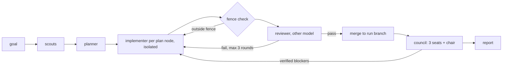

# node-loop

A multi-agent coding loop for omp.
You give it a goal. Scouts map the repo and a planner cuts the work into small **plan nodes**.
Each plan node is built in its own isolated checkout, then reviewed by a different model, until the review passes.
When every node has merged, a council of three models reviews the whole branch.

## Quick start

```text
/marketplace add exit-node/node-loop
/marketplace install node-loop@exit-node
exitnode setup
exitnode add magic-link login to the API
```

| Type | What it does |
|---|---|
| `exitnode <goal>` | Start a run in the current repo |
| `exitnode resume` | Continue the latest run after a restart |
| `exitnode setup` | Pick a model for each role and turn on isolation (rerun any time) |
| `exitnode view` | Open the live forge view in your browser |

`exitnode` only triggers as the first word of a prompt; `/exitnode ...` works too.
Restart omp after installing; a session that was already open never loads the keyword.

## How it works



- **No approval wait.** The plan is posted for you to read and the run keeps going; interrupt any time to change it. The planner only stops to ask when the goal leaves a real decision open.
- **Fresh agents only.** A failed review sends the work to a new implementer that reads the findings, not the old conversation.
- **Fence.** Every plan node lists the files it may touch. Changes outside it fail automatically, and reviewers fail unrequested extras too. Good ideas outside the fence land in `parking.md` for you.
- **Council.** Three models review the branch blind. The chair checks every finding against the code; one verified blocker is enough, no voting.
- **Safe by default.** Work happens on a `node-loop/<run>` branch. Nothing is pushed.

## Models

Each agent uses an omp model role, so you choose the models and keep them up to date with `exitnode setup`.

| Role | Used by | Example |
|---|---|---|
| `node-plan` | planner | `anthropic/claude-opus-5-5` |
| `node-implement` | implementer | `anthropic/claude-sonnet-5-5` |
| `node-review` | reviewer | `openai-codex/gpt-6.1-sol` |
| `node-chair` | council chair | `anthropic/claude-opus-5-5` |
| `council-seat-1..3` | council seats | one model from each provider you have |

Put the reviewer on a different provider than the implementer.
Three different providers on the council work best; the same model on two seats still runs, it just shares blind spots.

## Requirements

- omp 18.12 or newer, git, a git repo with a clean working tree.
- `exitnode setup` sets `task.isolation` to `enabled: true`, `merge: branch`, `apply: false`.

## Where things go

Run state lives outside your repo in `~/.omp/node-loop/<repo>/<run>/`: the plan, each plan node, reports, reviews, the council verdict, `parking.md`, `ledger.md` (one line per event) and `report.md`.
The forge view and `exitnode resume` both read `ledger.md`.

## For contributors and agents

[`docs/CONTRACT.md`](docs/CONTRACT.md) is the source of truth for names, file layout, agent schemas, the ledger grammar and the loop's steps.
Skills live in `skills/`, agents in `agents/`, the keyword hook, setup and forge view in `extensions/node-loop/`.

## License

MIT
